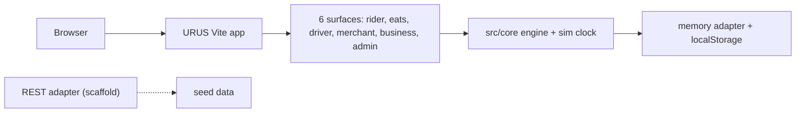

# U-b-e-r (URUS)

A config-driven ride-hailing and food-delivery marketplace simulation with six screens (rider, eats, driver, merchant, business, ops), running entirely in the browser on made-up data.

## What it is

A working demo of a two-sided mobility and delivery marketplace called URUS. A single simulated "world" (vehicles, drivers, merchants, orders, a clock) is shared by six front-end surfaces, so a ride requested in the rider view shows up as an offer in the driver view and on the ops map. All data is generated locally; there is no real backend, no accounts and no payments. It is not connected to any Gulf Coast, CyberCheck or database service.

## How it works

- `src/main.tsx` is the entry; `src/app/router.tsx` builds routes for each surface and redirects unknown paths to `/rider`.
- `src/surfaces/{rider,eats,driver,merchant,business,admin}` - the six products.
- `src/core/` - framework-free engine: `routing/` (A* on a generated road graph), `pricing/`, `dispatch/`, `lifecycle/`, `events/`, `geo/`, `sim/` (the world clock).
- `src/data/adapters/memory` keeps state in memory with localStorage persistence; `src/data/adapters/rest` is only a scaffold that falls back to the seed data.
- `src/data/seed/` builds the fake places, people, merchants and history.
- `config/*.config.ts` - all business values (brand, market, pricing, fleet, catalog, payments, org, seed).
- `tests/` - vitest tests for actions, marketplace, pricing and routing. Stack: Vite 5, React 18, react-router 6, zustand.

## Run it

```bash
npm install
npm run dev      # http://localhost:5173
npm run build    # typecheck + production build
npm test         # vitest run
```

No environment variables or external services are needed.

## Status

**Stalled.** A large, self-contained one-day build (single commit, 2026-08-30) with no consumer and no link to the rest of the platform. Its only branch on GitHub is `claude/uber-prototype-rebuild-wvt994`; there is no `main`.

## Where it fits



It calls no outside service and nothing calls it.

## Related repos

- `Spot-on` - sibling demo clone of another third-party product, built the same way (mock data, no backend); different code.
- `Toast`, `Yelp`, `L-y-f-t` and similar - other look-alike recreations in the same family.
